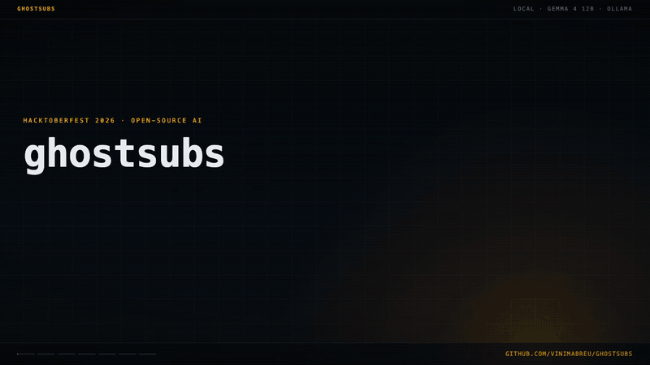

# ghostsubs

[](https://github.com/vinimabreu/ghostsubs/actions/workflows/test.yml)
[](https://www.python.org/downloads/)
[](LICENSE)

Drop the CSV exports of a bank or card account into a folder. Once a month you get one line about everything the account pays on repeat:

```text
$ ghostsubs line examples/bank-a.csv
7 subscriptions, R$ 267,35/mo (other recurring: R$ 2.659,39/mo). Netflix went up 13% (R$ 39,90 -> R$ 44,90). New: HBO Max (trial R$ 1,99, now R$ 34,90 monthly). No charge from Globoplay since 2026-08-08 (cancelled?).
```

The line reports a price that went up, a trial that turned into a paid plan, a yearly renewal that is close, and a service that stopped charging. You don't track anything yourself, so the money you stop leaking costs you no effort.

A bank statement is private, so the model runs on your own laptop: [Gemma 4](https://ollama.com/library/gemma4) (12B) through [Ollama](https://ollama.com), offline and free. Nothing leaves the machine unless you add `--ntfy` (the one line, to the ntfy server you choose) or `--allow-remote-model` (the descriptors, to that model). The model client only talks to an Ollama on this machine, ignores proxy settings and follows no redirects. It also refuses a cloud model served through the local Ollama (a name ending in `-cloud`, or a model Ollama reports as running elsewhere) unless you pass `--allow-remote-model`.



Every number in the animation comes from the command-line output and the files in [`measurements/`](measurements/).

## What the model does, and what code does

Banks print a charge as a descriptor: `PAYPAL *SPOTIFY 4025550134`, `AMZN Mktp US*2K4L19ZX0`, `DM *HBOMAX`, `ACH DEBIT OAKWOOD PROPERTY MGMT RENT`. Gemma reads each one and says which business it is. Everything else is plain code: which charges repeat, on what schedule and at what price, and when the next one is due. Every number you see comes from the statement through that code; no number in the line or the report is written by Gemma.

```mermaid
flowchart LR
    csv[CSV exports] --> read[read the files<br/>delimiter, headers, dates, signs]
    read --> key[clean each descriptor<br/>and make its cache key]
    key --> cached{answer cached?}
    cached -- no --> gemma[Gemma 4 on Ollama<br/>127.0.0.1, temperature 0]
    gemma --> store[(name cache<br/>per model)]
    store --> check
    cached -- yes --> check[check the name<br/>against the descriptor]
    check -- holds --> merge[merge descriptors<br/>by merchant]
    check -- fails --> fallback[cleaned descriptor<br/>marked UNVERIFIED] --> merge
    merge --> recur[find what recurs<br/>cadence, price, trial, renewal, stop]
    recur --> out[one line, report, JSON]
```



### The check on every name

For each new descriptor Gemma returns three things, as JSON: the merchant, the piece of the descriptor that names it (the evidence), and a kind (subscription, bill, loan_or_rent, other). [`naming.py`](ghostsubs/naming.py) keeps the name only when:

- the evidence is in the descriptor, character for character (case and runs of spaces aside);
- every word of the merchant is spelled out in the evidence. A word counts when it is a word of the evidence (`SPOTIFY`), when it is read off words glued together starting at the beginning of one of them (`YouTubePremium` gives YouTube Premium, `AMAZONPRIMEBR` gives Amazon Prime), or when the descriptor cut it short (`ENTRETENIMENT`, `DISNEY PLU`). A cut-short or glued word has to keep three quarters of its length, so `APPLE.COM` does not give Applebees and `NETFLIX` does not give Flix. A word also counts when it comes through one of two closed tables in the code;
- the merchant is not the payment processor in front of the real one: `PAYPAL *SPOTIFY` is Spotify, and an answer of PayPal is refused.

The two tables are short and can't add a brand. One has the abbreviations card networks and banks use to fit a name in about 22 characters, in English and Portuguese (`MGMT`, `SVCS`, `WRLS`, `WHSE`, `INS`, `COMM`, `Mktp`, `IMOB`, `DROG`): each turns one word of the evidence into one full word. The other has five abbreviations brands print for themselves in place of the name (`AMZN` for Amazon, `MSFT` for Microsoft, `NYT` and `NYTIMES` for The New York Times, `WSJ` for The Wall Street Journal). A descriptor without them doesn't contain the word at all: without `AMZN`, every Amazon purchase would fail.

A name that fails is not used. The report shows the descriptor cleaned up by code instead, marked UNVERIFIED, with what the model said and why it was refused. This one came from the example statements:

```text
UNVERIFIED NAMES (1): the model's name failed the check, the cleaned descriptor is shown
  PAGTO FATURA CARTAO  -> Fatura Cartao  (model said "PagSeguro", "PagSeguro" is not spelled out in "PAGTO")
```

`PAGTO` is the Portuguese bank abbreviation for "payment", and the line is a credit card bill paid from a checking account. Gemma read `PAG` as the PagSeguro processor and named it. The quote is in the descriptor, but PagSeguro is not spelled out in the quote, so the check refused the name.

The kind is a label the code can't check either way. It decides which of the two totals a recurring charge adds to (subscriptions, or other recurring: bills, rent, loans, transfers) and the heading it is listed under. It doesn't change whether a charge counts as recurring, its cadence or any amount. The report shows it next to every series. A fixed monthly transfer to your own savings is a recurring charge too, and it is counted under other recurring.

Descriptors that resolve to the same checked merchant are merged, so `PAYPAL *SPOTIFY 4025550134`, `EBN*SPOTIFY` and `SPOTIFY AB STOCKHOLM SE` are one Spotify subscription. Without the model, code cleanup gives `Spotify` for the first two and `Spotify Ab` for the third, and the one plan comes out as two: one that "stopped" in May and one that "started" in June.

### Slow the first time, instant after

Every answer is cached in `~/.cache/ghostsubs/` (or `$XDG_CACHE_HOME`, `$GHOSTSUBS_CACHE`, `--cache`), one file per model and prompt version, readable only by you. The cache key ignores case, spacing, digits and reference codes, so `AMZN Mktp US*2K4L19ZX0` and next month's `AMZN Mktp US*RT5Y21QX8` are one question. The check runs again on every use, so a cached answer gets no free pass.

On the four example statements, the first run asked Gemma 100 questions and took 101.8 seconds. The second run answered everything from the cache in 0.57 seconds; with no model at all it takes 0.53 seconds. The first-run times leave out loading the model into memory, because a warm-up call ran before them.

| statement | first run | questions to the model | from the cache | no model |
|---|---|---|---|---|
| bank-a.csv | 29.78 s | 28 | 0.11 s | 0.08 s |
| card-b.csv | 43.75 s | 44 | 0.30 s | 0.30 s |
| export-c.csv | 17.10 s | 17 | 0.08 s | 0.08 s |
| bank-d.csv | 11.15 s | 11 | 0.08 s | 0.07 s |

A new month's export only sends the model what the cache hasn't seen, such as a merchant you haven't paid before or a new spelling of one. The first run is slow once, and after that each descriptor has already been asked.

## Install

You need Python 3.11 or newer, and for the names, Ollama with the model:

```sh
ollama pull gemma4:12b
pipx install git+https://github.com/vinimabreu/ghostsubs
```

`pipx` keeps it in its own environment (Homebrew's Python refuses a plain `pip install`); `pip install` inside a virtual environment works too. There are no Python dependencies. Without Ollama, `--no-model` runs on code cleanup alone.

## Use

```sh
ghostsubs line statement.csv              # the one line
ghostsubs report statement.csv            # every recurring charge: dates, amounts, cadence, the quoted evidence
ghostsubs line jan.csv feb.csv mar.csv    # several exports at once; a row repeated across files counts once
ghostsubs report statement.csv --json     # everything, for a script
ghostsubs line statement.csv --no-model   # code cleanup only, no model
ghostsubs line statement.csv --model qwen3:8b   # any other local model Ollama serves
ghostsubs line statement.csv --host 127.0.0.1:11435   # Ollama on another port of this machine
```

`--host` must be this machine. `--allow-remote-model` lifts that, and also lets a cloud model through; then the descriptors go wherever that model runs, while the amounts stay here.

A monthly plan needs three charges before it counts, and a yearly one needs two charges a year apart. So export as many months as your bank allows, or drop each month's file into the same folder and point `watch` at it (below).

Part of the report for the US card example, cut where it says `...` (that file has no currency symbol in it, so `--currency '$'` adds one):

```text
$ ghostsubs report examples/card-b.csv --currency '$'
ghostsubs report: examples/card-b.csv
1483 charges and 27 credits, 2024-08-01 to 2026-10-14, counted from 2026-10-14
read as: dates mdy, decimal '.', charges type column
names: 108 descriptors (44 once codes are masked), 0 asked to gemma4:12b now, 44 from cache; 108 named and checked, 0 UNVERIFIED (cleaned up by code)

13 subscriptions, $191.96/mo (other recurring: $217.40/mo). Spotify went up 8% ($11.99 -> $12.99). Adobe Creative Cloud renews in 9 days: $239.88. New: Audible (trial $0.99, now $14.95 monthly). No charge from Max since 2026-08-15 (cancelled?).

SUBSCRIPTIONS (13, $191.96/mo)
  ...
  Adobe Creative Cloud     yearly             $239.88        $19.99/mo  next 2026-10-23 (in 9 days)
      subscription
      named from:
      ADOBE *CREATIVE CLOUD 408-555-0122 CA  <- "ADOBE *CREATIVE CLOUD"
      2 charges: 2024-10-23 $239.88 · 2025-10-23 $239.88
  Hulu                     monthly             $17.99        $17.99/mo  next 2026-11-09 (in 26 days)
      subscription
      went up 20% on 2025-10-09: $14.99 -> $17.99
      named from:
      HULU 877-555-0199 CA  <- "HULU"
      27 charges: 2024-08-09 $14.99 · 2024-09-09 $14.99 · 2024-10-10 $14.99 · 2024-11-09 $14.99 ...
  ...
  YouTube Premium          monthly             $13.99        $13.99/mo  next 2026-10-27 (in 13 days)
      subscription
      named from:
      GOOGLE *YouTubePremium g.co/helppay#  <- "YouTubePremium"
      GOOGLE *YouTube Premium  <- "YouTube Premium"
      YOUTUBEPREMIUM GOOGLE.COM CA  <- "YOUTUBEPREMIUM"
      26 charges: 2024-08-27 $13.99 · 2024-09-27 $13.99 · 2024-10-27 $13.99 · 2024-11-27 $13.99 ...
  ...

STOPPED: EXPECTED CHARGE MISSING, MAYBE CANCELLED (2)
  ...
  Max                      monthly             $15.99        $15.99/mo  expected 2026-09-15, not charged
      other
      named from:
      HELP.MAX.COM  <- "HELP.MAX.COM"
      25 charges: 2024-08-15 $15.99 · 2024-09-15 $15.99 · 2024-10-15 $15.99 · 2024-11-15 $15.99 ...

REGULAR, AMOUNT VARIES, NOT COUNTED ABOVE (1)
  Harborlite Electric      monthly       $76.18 to $189.86
      26 charges: 2024-08-20 $150.15 · 2024-09-19 $162.63 · 2024-10-21 $139.25 · 2024-11-21 $124.24 ...

REFUNDS MATCHING A CHARGE (1)
  2025-07-30 $56.74 back from Amazon Marketplace for the 2025-07-21 charge (AMZN Mktp US*24DFGPZAN)
```

Days are counted from the last date in the statement that is not in the future, so installments booked months ahead don't make every plan look stopped (the report says how many rows it left out). A file without future rows gives the same line every time you run it; a file with them moves with the clock, until `--today` fixes the day. `--today 2026-10-19` counts from another day. `--window 30` is how far ahead a quarterly or yearly renewal is mentioned.

Swapping the model is one flag, and that is part of why open weights matter here: the same local, offline setup works with whatever model you trust or your machine can run, and [`scripts/measure.py --model`](scripts/measure.py) measures it on the same ground truth.

### Once a month, on its own

`ghostsubs watch FOLDER` reads every CSV in the folder, compares the result with what it saw last time, and prints the line only when something new shows up: a new recurring charge, a new price, a stop, a renewal coming into the window, or a possible trial turned paid. Something leaving the line (a renewal that passed, a plan that is no longer new) is not news, so a month with nothing new prints nothing and a scheduler sends nothing. Overlapping exports are fine, since a row repeated across files counts once.

A file in the folder that is not a statement it can read (a contacts list, a file with ambiguous dates) is skipped and named on stderr, and hidden files such as `._statement.csv` are ignored. When the run can't finish at all (no readable file, Ollama down while a new descriptor needs a name), it exits with code 2 and, with `--ntfy`, sends "ghostsubs could not run:" and the reason to your phone, once per distinct reason, so a broken setup doesn't stay silent or repeat itself every day. That note names the problem and the file, and leaves the file's contents out.

A crontab line for the first day of each month at 9:00. Use the path `command -v ghostsubs` prints (pipx puts it in `~/.local/bin`), and make a topic name with `openssl rand -hex 16`:

```cron
0 9 1 * * $HOME/.local/bin/ghostsubs watch $HOME/Statements --ntfy <your-random-topic>
```

On macOS, the same with launchd, in `~/Library/LaunchAgents/dev.ghostsubs.watch.plist` (then `launchctl load` that file):

```xml
<?xml version="1.0" encoding="UTF-8"?>
<!DOCTYPE plist PUBLIC "-//Apple//DTD PLIST 1.0//EN" "http://www.apple.com/DTDs/PropertyList-1.0.dtd">
<plist version="1.0">
<dict>
    <key>Label</key><string>dev.ghostsubs.watch</string>
    <key>ProgramArguments</key>
    <array>
        <string>/Users/you/.local/bin/ghostsubs</string>
        <string>watch</string>
        <string>/Users/you/Statements</string>
        <string>--ntfy</string>
        <string>your-random-topic</string>
    </array>
    <key>StartCalendarInterval</key>
    <dict><key>Day</key><integer>1</integer><key>Hour</key><integer>9</integer></dict>
    <key>StandardErrorPath</key><string>/Users/you/Library/Logs/ghostsubs.log</string>
</dict>
</plist>
```

`--ntfy` pushes the line to your phone through [ntfy](https://ntfy.sh), the open-source push service. Apart from `--allow-remote-model`, which sends the descriptors to the model you point it at, it is the only thing that leaves the machine. The line holds merchant names and amounts. A name can be a person you pay by transfer, and a name the check refused is the cleaned descriptor, so read one line before you turn the push on. On ntfy.sh anyone who knows a topic's name can read it; use a random one, or run your own ntfy server and pass `--ntfy-server`. If the push fails, the watch state is not saved, so the next run tries again.

## How a recurring charge is found

[`recur.py`](ghostsubs/recur.py) groups the charges by checked merchant and looks for a schedule:

| cadence | interval between charges | charges needed | counted per month as |
|---|---|---|---|
| weekly | 5 to 9 days | 6 | amount × 52 / 12 |
| monthly | 25 to 36 days | 3 | amount |
| quarterly | 80 to 100 days | 3 | amount / 3 |
| yearly | 350 to 380 days | 2 | amount / 12 |

The cadence is the one the median interval falls in. One missed charge inside a weekly, monthly or quarterly series is allowed (one interval of about twice the cadence). A yearly plan needs two charges, so it takes a statement of more than a year to see one.

- **Same price**: amounts within 5% count as one price (card exchange rates move a little; `--tolerance` changes it). A step beyond that is a price change, reported with its date, the old and new amount and the percentage. A price change counts only after the first price recurred on its own (three monthly charges), and a new price seen once counts only when nothing else was charged in between. A yearly pair has to agree within 1%.
- **On a schedule**: a plan bills on the same weekday, day of the month or day of the year. All the charges of a series have to land within a few days of one fixed schedule (3 days weekly, 6 monthly, 8 quarterly, 10 yearly), which purchases that happen to be about a month apart don't do. A plan that bills every N days instead (every 4 weeks, every 30 days) counts once it has 5 charges that land within 4 days of that spacing; the report says "every 28 days", the next charge is the last one plus 28 days, and the monthly cost is the amount times 30.44 / 28.
- **Charged twice**: a charge that repeats one of the series (same descriptor, same amount, within 3 days) is set aside and listed in the report as "charged twice?", and the plan stays a plan.
- **Its own descriptor**: at least half of the charges printed under the same cleaned descriptor during the series have to be the series (all of them for a yearly pair). A ride that cost the same twice a year apart is one of a hundred rides under `UBER *TRIP`, while a ride pass is the only charge under `UBER *ONE`.
- **Not a subscription**: a merchant you pay often at different amounts (groceries, rides, coffee, cash withdrawals) doesn't hold one price on a calendar under its own descriptor, so it is not counted. A monthly bill whose amount keeps moving (electricity) is listed apart, as regular with a varying amount, and counted in no total. The end of such a bill (a few similar months after a year of different ones) is refused too.
- **Hidden plans**: a membership among purchases at the same store (a yearly warehouse club fee among weekly shopping, a ride pass among rides, Prime among Amazon orders) is found in a second pass by its exact amount, as long as it has a descriptor of its own. There a price only counts when it repeats to the cent and the same price (within 1%) doesn't also show up off the schedule under that descriptor. Two pieces at different exact prices join as one price change only under the same descriptor and within a factor of 1.5.
- **Trial to paid**: a charge of at most a quarter of the price, up to 45 days before a series starts. Until the paid plan has charged three times it can't count as recurring, so the line says "possible trial turned paid" as soon as a small first charge at a merchant is followed by one or two full ones about a month apart, the last one in the past month. A new shop starts the same way (a small purchase, then a bigger one), so this early flag only appears for a merchant the model labels a subscription, or for any merchant when you run with `--no-model`.
- **New**: the charge that made it recurring landed in the last 31 days, and the statement reaches back far enough to show nothing came before it (weekly and monthly plans).
- **Renews soon**: the next charge is the last one plus the cadence, on the same day of the month. Quarterly and yearly renewals within `--window` days go in the line.
- **Stopped**: the expected charge is overdue by more than a grace period (3 days weekly, 7 monthly, 14 quarterly, 21 yearly). The line mentions stops from the last two months as "cancelled?", because the statement can't tell a cancellation from a failed card.
- **Refunds** are not subtracted. A credit that matches a charge (same amount, same merchant, within 60 days) is listed in the report.

## Files it reads

[`statement.py`](ghostsubs/statement.py) finds the header row (even under a few lines about the account), maps the columns, and decides each convention once for the whole file:

- delimiter: comma, semicolon, tab or pipe;
- headers in English and Portuguese: date/data, description/descrição/title/histórico/memo/payee, amount/valor, or separate debit/débito and credit/crédito columns, plus a type column (Sale, Payment, Return, Débito, Crédito, with or without accents);
- amounts like `1,234.56`, `1.234,56`, `-R$ 39,90`, `R$ -39,90`, `(12.00)`, `12,00-` and `39,90 D`, including files where only the credits carry a `C`;
- dates as `2026-10-19`, `19/10/2026` or `10/19/2026` (also with `-` or `.`, two-digit years, a time after it);
- UTF-8 with or without a byte order mark, and Windows-1252;
- balance and total rows (`SALDO DO DIA`, `Total`) are skipped and counted.

Two things it refuses to guess. If every date in the file fits both day/month and month/day, it stops and asks for `--date-format dmy` or `mdy`. The sign of a charge comes from debit and credit columns, D/C markers or a type column when the file has them. Otherwise it is decided by the sign of most rows (at least 60% of them), and the report says the vote decided it. An account that receives more often than it pays can turn that vote around, so when most rows that say money came in (salary, PIX received, deposit, refund) would become charges, or most that say money went out would become credits, it stops and asks for `--debits negative` or `--debits positive`. It does the same when neither sign reaches 60%.

The four statements in [`examples/`](examples/) are made up and cover these formats: [`bank-a.csv`](examples/bank-a.csv) is a Brazilian checking account (semicolons, `1.234,56`, balance rows). [`card-b.csv`](examples/card-b.csv) is a US credit card with a type column; it covers 26 months, so its yearly plans renew in view. [`export-c.csv`](examples/export-c.csv) is a messy card export (tabs, Windows-1252, a preamble, `R$` in every cell, credits in parentheses, a total row), and [`bank-d.csv`](examples/bank-d.csv) a US checking account with debit and credit columns. [`scripts/make_examples.py`](scripts/make_examples.py) writes the four files and their truth from a random seed. It plants monthly, weekly, quarterly and yearly plans, price increases, trials, cancellations, one plan under three descriptors, and decoys: weekly groceries, rides, a fixed rent, a bill whose amount moves, a coffee at the same price every few days, cash withdrawals at round amounts, and purchases at stores that also charge a membership. Brand names are real, since recognising them is the job. Every card number, phone number (555-01xx numbers), reference, landlord, lender, local shop, utility, restaurant and person is invented; the real brands are national or international ones.

## Measured

Everything here comes from runs of [`scripts/measure.py`](scripts/measure.py), [`scripts/measure_seeds.py`](scripts/measure_seeds.py) and [`scripts/measure_trials.py`](scripts/measure_trials.py) on 19 October 2026, against `gemma4:12b` (digest `6114515d63c1`, Q4_K_M) on Ollama, on an Apple Silicon laptop, with the code of commit `a20cc70` (each file lists the hash of every module under `code_sha256`). The raw output is in [`measurements/`](measurements/): [naming](measurements/2026-10-19-gemma4-12b-naming.json) (every answer of every run), [end to end](measurements/2026-10-19-gemma4-12b-endtoend.json), [other seeds](measurements/2026-10-19-gemma4-12b-seeds.json) (and [the same on the previous version](measurements/2026-10-19-gemma4-12b-seeds-previous-version.json)), [timing](measurements/2026-10-19-gemma4-12b-timing.json), [trial flags on new shops](measurements/2026-10-19-trial-flags.json), and the [summary](measurements/2026-10-19-gemma4-12b-summary.md) generated from the naming, end-to-end and timing files.

These numbers come from my own made-up data, and part of that data shaped the code. I wrote the prompt (version 2), the abbreviation table and the rule for names given as web addresses while looking at the model's answers for the example statements. Those statements hold 71 of the 159 descriptors in the naming set and all 42 planted series. The recurrence rules added in this version came from a review that ran other seeds of the same generator, so the seed runs below are not independent of the code either, and they reuse the same descriptors. Nothing here is a held-out benchmark.

### Names

159 made-up descriptors in [`examples/truth/descriptors.json`](examples/truth/descriptors.json), each with the names that count as right, asked three times with no cache. Many are built to be hard: processors in front (`PADDLE.NET* SETAPP`, `2CO.COM|AVAST`, `CKO*PATREON* MEMBERSHIP`), names glued or cut short (`AMAZONPRIMEBR`, `DISNEY PLU*2K3J4L`), brand abbreviations (`MSFT *E0300ABCDE`, `NYT*DIGITAL SUBSCRIPTION`), bank labels (`PURCHASE AUTHORIZED ON 03/14 WHOLEFDS MKT 10234 AUSTIN TX`), Brazilian descriptors (`TED ALUGUEL IMOB HORIZONTE`, `MP*MELIMAIS`).

| | Gemma 4 + check | code cleanup only |
|---|---|---|
| name shown is right | **148** of 159 | 99 of 159 |
| passed the check and right | 148 | |
| passed the check, right but cut short | 2 | |
| passed the check and wrong | 6 | |
| refused by the check | 3 | |
| kind label right | 141 | |
| subscription or not, right | 154 | |

On the 71 descriptors that also appear in the example statements, 65 names were right (43 with cleanup only); on the other 88, 83 were right (56 with cleanup only). The three runs gave character-identical answers for all 159 descriptors (temperature 0).

A name counts as right when, ignoring case, spacing, punctuation and words like Inc, it equals one of the accepted names. An accepted name is the brand, the company's full name or a product name written out (Costco Wholesale, Comcast Cable Communications, Netflix Entretenimento). The descriptor's own abbreviations and labels are not accepted (`Imob Horizonte`, `Oakwood Property Mgmt`, `Aluguel Imob Horizonte`, where "aluguel" means rent). I widened the accepted names twice after seeing model output (once after a trial run on the example statements, once after a first measurement), and only with correct full names I had left out. After the review I removed the entries that kept descriptor labels, so a name that keeps them counts as wrong.

What passed the check and was wrong: `Wholefds Mkt` (twice, `WHOLEFDS MKT` left unexpanded), `Aluguel Imob Horizonte`, `Quillmont Auto Financial Svcs` and `Parc Financ Morada Nova` (each kept the bank's label or an abbreviation around the name), and `99Ride` for the 99 app. Each quote is real and does spell the name. The check proves that a name is grounded in the descriptor, and these show where that stops. Cut short: `Planet Fit` (twice). Refused: `Kindle Unlimited` from `Kindle Unltd`, `Adobe Acrobat` from `ACROPRO` and `Walmart Supercenter` from `WM SUPERCENTER`. All three are right, and none can be read off the descriptor by the rules in the check, so the cleaned descriptor is shown instead. I chose a strict check on purpose: a right name that is refused costs a plainer label, and a wrong name that passes can merge two merchants.

After a review I made the check stricter (a cut-short or glued word must keep three quarters of its length and start at the beginning of a word) and ran it over the 159 answers of the previous measurement: none changed outcome. `COMM` went into the abbreviation table in the same change, because the stricter rule would otherwise refuse Comcast Cable Communications.

Of the 18 wrong kinds, 10 are bills labeled other: GEICO, Porto Seguro, NET, Sky, Sem Parar, and five utilities whose names are invented for this set (a model can't know what Sanevale or Harborlite sells). One student loan is labeled other, 2 charges are labeled rent or loan (Prudential insurance, Airbnb), and 5 subscriptions are labeled other (Max, from its `HELP.MAX.COM` descriptor, HelloFresh, Namecheap, Sketch and Meli+). A subscription labeled other moves from the subscription total to the other one. In this set the model labeled nothing else a subscription.

### End to end

The four statements hold 42 planted recurring series ([`examples/truth/statements.json`](examples/truth/statements.json)): monthly, weekly, quarterly and yearly plans, bills, rent, a loan, a transfer to savings, with price changes, trials and cancellations. A series is right when the reported cadence, current amount and name all match. (Before the first run I fixed the truth file itself: it had the scheduled date of each price change, where the statement shows the date the charge posted.)

| | with Gemma 4 | code cleanup only |
|---|---|---|
| series reported | 42 | 45 |
| right schedule, amount and name | **37** | 24 |
| right schedule and amount, other name | 5 | 18 |
| missed | 0 | 0 |
| reported but not planted | **0** | 3 |

With the model, every planted series was reported with the right cadence and current amount, and nothing else was reported. All 37 with the right name also had the right status (active or stopped), price changes with their dates, trial and "new" flags, and the one renewal in the window; 3 of the 37 sat in the wrong total because of the kind label. The 5 under another name are `Planet Fit` twice, `SAV` for a transfer to savings, `Aluguel Imob Horizonte` for the landlord and `Quillmont Auto Financial Svcs` for the car loan.

Without the model the schedules are found just as well, since that part is code, but the names split one plan into two. The 3 extra series are halves of Netflix, Spotify and YouTube Premium after the descriptor changed, and three plans that were still being paid were reported as stopped. A false "cancelled?" is the kind of mistake that makes someone stop trusting the line, and merging those descriptors is what the model is for.

### Other seeds

The example statements are the ones the code was tuned on. [`scripts/measure_seeds.py`](scripts/measure_seeds.py) writes them again with seeds 1 to 10: the same planted plans, with other dates, amounts, posting delays and decoys. That gives 40 statements and 420 planted series, named by Gemma and scored the same way.

| | 10 other seeds |
|---|---|
| series reported | 420 |
| right schedule, amount and name | 370 |
| right schedule and amount, other name | 50 |
| missed | 0 |
| reported but not planted | **0** |
| "possible trial turned paid" flags | 0 |

The 50 under another name are the same five names as above, once per seed. A review of the previous version found series that were not planted in runs like this one, and the [same run on that version](measurements/2026-10-19-gemma4-12b-seeds-previous-version.json) shows it: 17 of them in 9 of the 10 seeds, 15 still active and so inside the total. Fourteen were two charges that cost about the same a year apart at a merchant paid often (rides, groceries), read as a yearly plan; two were runs of equal cash withdrawals read as weekly, and one was an electricity bill. The calendar, descriptor and pair rules above came from that review, and its cases are in the tests. A second review added the every-N-days schedule, the duplicate charge and the exact pass limited to the plan's own descriptor, because the stricter rules had dropped real plans of those shapes; with them in, the seeds still report nothing that was not planted. The suite also runs 25 seeds of two years of rides, coffee, pizza and cash, expecting no plan at all, and six more seeds of the examples with the recorded answers. No seed here has a trial that is still in its first paid months, so the zero flags show only that the early trial flag did not fire on decoys.

### Speed

In the naming runs the median call took 0.75 s in run 1 and 0.39 to 0.40 s in runs 2 and 3; in the command-line runs above it was about 1.02 s per question (101.8 s for 100). Both were measured on the same laptop within minutes of each other. I did not find the cause of the difference, so the table above shows the slower numbers a person would see.

## What it can't do

- It reads the statement alone, so it reports what you pay for. Whether you still use a subscription is for you to judge.
- A yearly plan needs two charges a year apart in the files you give it; with one, it is a single charge like any other.
- A subscription has to recur on the card or account you exported. A plan billed through an app store under one descriptor (`APPLE.COM/BILL`) shows as Apple, and several plans at the same price on the same descriptor can't be told apart.
- A plan has to own its descriptor. One billed under the same descriptor as other charges that outnumber it in the same months (an annual fee printed exactly like the store's sales, a monthly fee under the same name as weekly purchases) is not found.
- A yearly plan seen twice has to match within 1% and be the only charge under its descriptor in that year. A yearly plan billed in another currency usually moves by more than 1% between renewals, and is then not found.
- A plan whose first two charges in the file are at an old price, and whose amount then moves by cents from month to month (a plan billed in a foreign currency), is not found at all: the old price did not recur on its own, the later charges start a cadence after an earlier charge, and the exact pass needs the same amount to the cent.
- A name the check refuses can split one plan in two when other spellings of it pass. Gemma's Spotify from `SPOTIFYUSA` keeps only 7 of the 10 letters, so that month shows as `Spotifyusa` while the months printed `SPOTIFY USA` show as Spotify; `LINKEDINPRE`, `HULUAPP` and `YOUTUBEPREMIUM` read as LinkedIn, Hulu or YouTube behave the same way.
- "Stopped" means the expected charge didn't come. A failed card, a pause and a cancellation all look the same.
- Two plans at the same price from the same merchant on the same cadence (two accounts of one service, billed on different days) are not found: each one's charges look like the same price showing up off the other's schedule. At different prices both are found.
- "Possible trial turned paid" depends on the kind label for new merchants: a new shop that the model labels a subscription can raise it, and with `--no-model` any new shop where a small purchase came before a bigger one can. A [simulation](measurements/2026-10-19-trial-flags.json) of two years with new shops and no plan at all ([`scripts/measure_trials.py`](scripts/measure_trials.py)) gave a false flag in 23 of 120 month-end runs without labels with 4 new shops a month, and in 71 of 120 with 12. With every shop labeled other, as the model labels shops, it gave 0 and 0.
- The formats above are the ones tested. A bank that writes amounts in a way not listed may need `--debits` or `--date-format`, and a file it can't read is refused with the reason. The check on the sign vote reads a list of Portuguese and English words, so a bank that labels deposits differently gets no such check.
- Names can be wrong in two ways. A refused name falls back to the code cleanup and is marked UNVERIFIED in the report. A name can also pass the check and still be wrong, when the quote is real and spells the name but the reading is wrong. The measurement counts those, and the report shows the quote next to every name so you can see what it was based on.
- The kind label is the model's judgement and is not checked. A wrong kind moves a charge between the two totals; the amounts and dates stay right.

## Development

```sh
pip install -e '.[test]'
pytest                                   # replays recorded answers; the one real-model test skips without Ollama
python scripts/make_examples.py          # rewrite the four CSV files and examples/truth/statements.json (same bytes every run)
python scripts/measure.py                # the measurement above, against your local model
python scripts/measure.py --record tests/recorded_names.json   # and refresh the answers the tests replay
python scripts/measure_seeds.py          # the ten other seeds
python scripts/measure_trials.py         # early trial flags on new shops, no model needed
```

[`examples/truth/descriptors.json`](examples/truth/descriptors.json) is written by hand. The test suite needs no model and no network: a fake model answers the unit tests, and [`tests/recorded_names.json`](tests/recorded_names.json) replays the answers gemma4:12b gave for the example statements, also across six other seeds. [`tests/test_real_model.py`](tests/test_real_model.py) asks the real model a few names when an Ollama with gemma4:12b is running on the machine, and is skipped otherwise.

## License

MIT, see [LICENSE](LICENSE).
